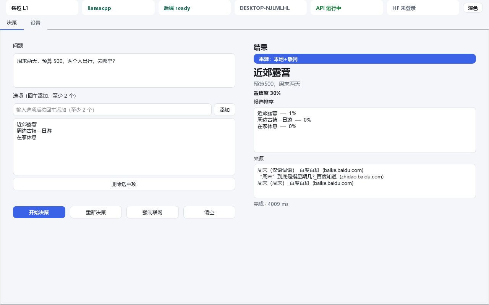
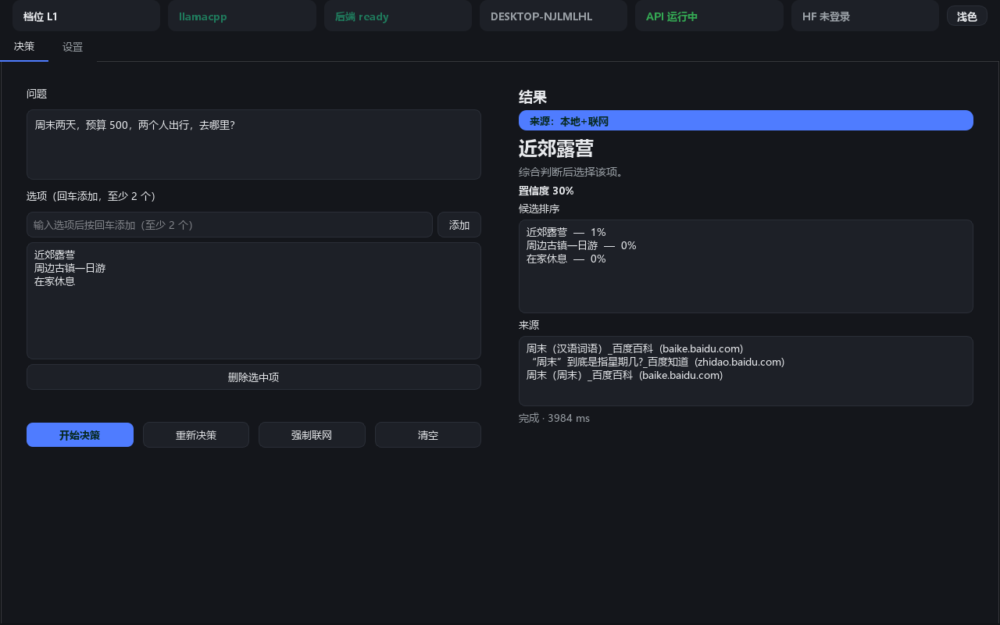
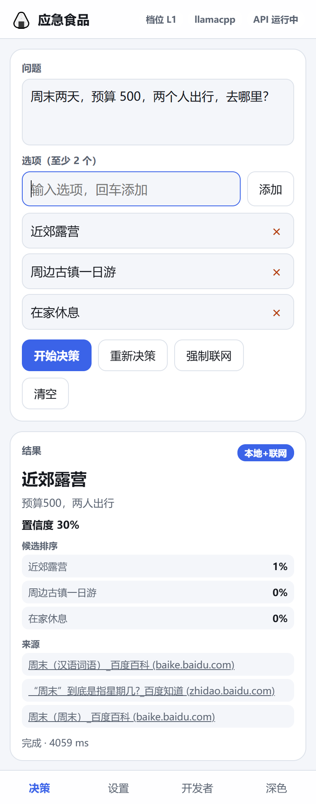
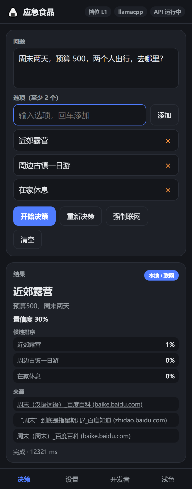

# 应急食品 · paimind

本地小型决策模型 App：**本地小模型优先，置信度不足或问题有时效性时自动联网**，最终只输出「选中项 + 一句话理由 + 置信度 + 来源徽标」。
> *A local-first decision app: a small local model decides; when confidence is low or the question is time-sensitive it searches online, and always answers with just the pick, a one-line reason, a confidence and a source badge.*

| 桌面版 · 浅色 / Desktop, light | 桌面版 · 深色 / Desktop, dark |
|---|---|
|  |  |

| 手机版 · 浅色 / Mobile, light | 手机版 · 深色 / Mobile, dark |
|---|---|
|  |  |

桌面端与手机版都支持自选深浅色。
> *Both the desktop app and the mobile PWA let you pick light or dark.*

---

## 特性 / Features

- **本地优先 / Local first**：INT4 量化小模型纯 CPU 可跑，L0 首次响应 < 3 秒。
  *INT4-quantised small models run on CPU alone; L0 answers in under 3 seconds.*
- **智能联网求助 / Smart online fallback**：置信度不足或含时效性关键词时自动检索再决策，断网静默回退本地。
  *Falls back to web search on low confidence or time-sensitive questions; degrades silently offline.*
- **四档三态 / Four tiers, three states**：L0–L3，ready/warning/disabled，跑不动的档位自动置灰并说明原因。
  *Tiers L0–L3 with ready/warning/disabled; unusable tiers grey out with an explanation.*
- **五种部署模式 / Five deploy modes**：内置 ONNX / Ollama / vLLM / llama.cpp / Docker，每档可独立切换。
  *Builtin ONNX, Ollama, vLLM, llama.cpp and Docker — switchable per tier.*
- **GitHub + HF 双主源 / GitHub + HF dual sources**：多镜像降级、断点续传、SHA256 校验、自定义源。
  *Multi-mirror fallback, resume, SHA256 verification and custom sources.*
- **上传闭环 / Upload loop**：把档位传到自己的 HF 仓库，一键设为下载源，别的设备直接拉。
  *Upload a tier to your own HF repo and make it a download source for other devices.*
- **三端同构 / One core, three shells**：桌面（Win/macOS/Linux）、手机版、HTTP API 共用 `core/`。
  *Desktop (Win/macOS/Linux), mobile and HTTP API all share the same `core/`.*
- **自选深浅色 / Light or dark**：桌面版状态栏与 PWA 底栏各有一个切换按钮，选择会被记住。
  *A toggle in the desktop status bar and in the PWA tab bar; the choice is remembered.*

---

## 30 秒快速开始 / Quick start

### 内置 ONNX（默认，最短路径）/ Builtin ONNX (default, shortest path)

```bash
# Windows / Linux
uv venv --python 3.12 .venv
uv pip install --python .venv/Scripts/python.exe -r requirements.txt
python -m server                 # API: http://127.0.0.1:8686  (/docs 可调试)
python -m desktop                # 桌面版（会自动拉起 API）
```

```bash
# macOS (Apple Silicon / Intel)
uv venv --python 3.12 .venv
source .venv/bin/activate
pip install -r requirements-macos-arm64.txt   # Apple Silicon
pip install -r requirements-macos-x86_64.txt  # Intel
python -m server && python -m desktop
```

首次使用先下载 L0（约 300 MB）：打开桌面版 → 设置 → 档位卡片 → 下载。
> *Download L0 (~300 MB) first: desktop → Settings → tier card → Download.*

### Ollama / Ollama

```bash
# 安装 / install
#   Windows / macOS: https://ollama.com/download
#   Linux: curl -fsSL https://ollama.com/install.sh | sh
ollama pull qwen2.5:1.5b
# App 设置页把档位切到 ollama 模式即可 / switch the tier to ollama in Settings
```

### vLLM（需 NVIDIA GPU + Linux）/ vLLM (needs NVIDIA GPU + Linux)

```bash
pip install -r requirements-vllm.txt
vllm serve Qwen/Qwen2.5-7B-Instruct-AWQ --quantization awq --max-model-len 4096 --port 8000
```

### llama.cpp / llama.cpp

```bash
# -ngl 99 把层全放到 GPU；-fa on 必须给，否则 CUDA offload 会静默失败退回 CPU
# *-ngl 99 offloads every layer; -fa on is required or CUDA offload fails silently*
llama-server -m qwen2.5-1.5b-q4_k_m.gguf --port 8080 -ngl 99 -fa on -c 4096
```

### Docker / Docker

```bash
docker compose -f deploy/docker-compose.ollama.yml up -d
docker compose -f deploy/docker-compose.vllm.yml up -d   # 需 NVIDIA GPU + Linux
```

### 手机版 / Mobile

```bash
# PWA（零安装，手机浏览器打开即可）/ PWA (zero install, open in a phone browser)
python -m server          # 然后手机访问 http://<电脑IP>:8686/app
# Flutter（可选编译）/ Flutter (optional build)
cd mobile/flutter && flutter build apk --release
```

---

## 目录结构 / Layout

```
paimind/
├── core/           三端共用的核心逻辑 / shared core logic
│   ├── inference/  推理后端抽象层 / inference backend abstraction
│   └── ...
├── server/         FastAPI 服务 / FastAPI service
├── desktop/        PySide6 桌面版 / PySide6 desktop
├── mobile/
│   ├── flutter/    Flutter 手机版 / Flutter mobile
│   └── pwa/        响应式 Web 版 / responsive web app
├── deploy/         Docker compose 与 Modelfile
├── examples/       调用示例 / client examples
├── docs/           完整文档 / full documentation
├── models/         模型与校验清单 / models + checksums
└── tests/          测试套件 / test suite
```

---

## 硬件要求 / Hardware requirements

| 档位 / Tier | 参数量 | 磁盘 | 峰值内存 | 可用内存下限 |
|---|---|---|---|---|
| L0 | 0.5B | ~300 MB | ~1.2 GB | ≥ 1.5 GB |
| L1 | 1.5B | ~1 GB | ~2.8 GB | ≥ 3 GB |
| L2 | 3B | ~2 GB | ~5 GB | ≥ 6 GB |
| L3 | 7B | ~4.5 GB | ~10 GB | ≥ 12 GB |

详见 [docs/tiers.md](docs/tiers.md)。
> *See [docs/tiers.md](docs/tiers.md) for the full tri-state rules.*

---

## 文档 / Documentation

[docs/](docs/) 下 14 篇：架构、API、模型、档位、下载、上传、GPU、联网、部署、用户手册、开发指南、变更日志、流程图。
> *14 documents under [docs/](docs/): architecture, API, models, tiers, download, upload, GPU, online, deploy, user guide, development, changelog and flow diagrams.*

---

## 已知限制 / Known limitations

### 各部署方式的局限 / Per-mode limitations

| 方式 / Mode | 局限 / Limitation |
|---|---|
| **Ollama** | 并发能力弱，不适合生产高并发；单用户场景最优。 |
| | Weak concurrency — built for single users, not production load. |
| **vLLM** | 必须有 NVIDIA GPU；**Windows / macOS 不可用**；7B AWQ 需 ≥ 8 GB 显存。 |
| | Requires an NVIDIA GPU; **unavailable on Windows and macOS**; 7B AWQ needs ≥ 8 GB VRAM. |
| **llama.cpp** | CUDA 初始化失败会**静默回退 CPU**（本机实测 53.9 s → 3.5 s）；需自行确认 offload 生效。 |
| | A failed CUDA init falls back to CPU **silently** (measured 53.9 s → 3.5 s); verify the offload. |
| **Docker** | 增加运维复杂度；App 只探测与连接，不管容器生命周期。 |
| | Adds operational complexity; the app only probes and connects. |
| **内置 ONNX** | Windows 上 `onnxruntime` 默认是 CPU 版；要用 GPU 得换 `onnxruntime-gpu`。 |
| | The default Windows wheel is CPU-only; swap in `onnxruntime-gpu` for CUDA. |
| **PWA 手机版** | 浏览器跑 ONNX（WASM）性能低于原生；重推理仍建议桌面或 Flutter。 |
| | Browser ONNX (WASM) is slower than native; prefer desktop or Flutter for heavy use. |

### 通用限制 / General

- **未随包分发模型** —— 首次使用需下载（L0 约 300 MB）。
  *No model ships in the package — the first use downloads one (~300 MB for L0).*
- **联网搜索质量依赖 provider** —— Bing 网页抓取对关键词式查询效果好、对自然语言句子差；建议配置 SerpAPI / Bing API key。
  *Search quality depends on the provider — the Bing scraper prefers keywords over sentences; configure a search API key for best results.*
- **DuckDuckGo 端点在国内网络常被阻断** —— 已加 Bing 网页抓取作为无 key 备用。
  *DuckDuckGo's endpoint is often blocked on some networks; a Bing scraper serves as the key-less fallback.*
- **`core/download.py` 目前是单连接下载** —— 大文件可考虑多线程分块提速。
  *Downloads are single-stream; parallel chunked downloading would speed up large files.*
- **Flutter 手机版只验证了 Android** —— 已产出签名 APK（`dist/app-release.apk`，76 MB），iOS 未编译。
  *The Flutter app is verified on Android only — a signed APK ships at `dist/app-release.apk` (76 MB); iOS is unbuilt.*
- **macOS 打包未验证** —— 签名 / 公证命令已给出，需 macOS 环境实测。
  *macOS packaging is unverified — the sign and notarize commands are provided but need a real macOS run.*

### 后续优化建议 / Suggested next steps

1. `core/download.py` 支持多线程分块下载（提速最明显）。
   *Multi-threaded chunked downloads — the biggest speed win.*
2. 内置 ONNX 后端支持 LoRA 与多模型热切换。
   *LoRA support and hot-swapping between models in the builtin backend.*
3. 联网搜索加 rerank（用本地模型对 top-N 重排）。
   *Rerank search results with the local model.*
4. 桌面端加托盘常驻 + 全局快捷键唤起。
   *System tray residency and a global hotkey in the desktop app.*
5. 移动端用 NNAPI / CoreML 委托进一步提速。
   *Further mobile speedups via NNAPI/CoreML delegates.*

---

## 许可证 / License

MIT
