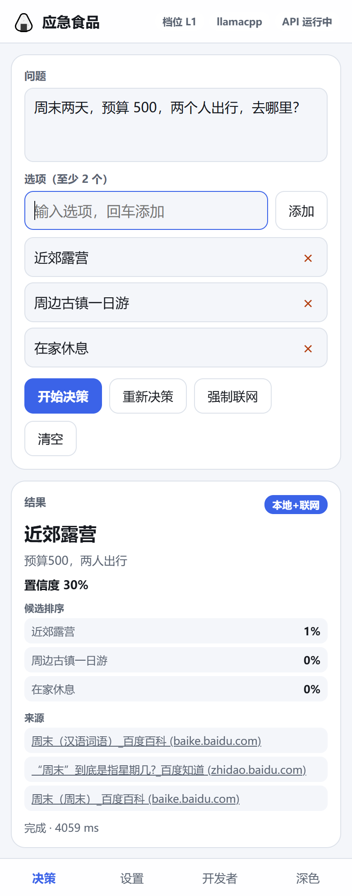
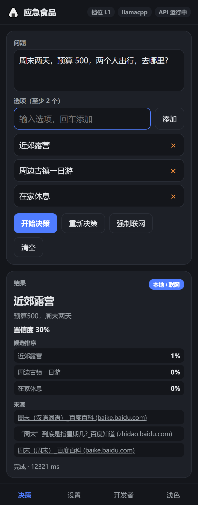

# 用户手册 / User guide

## 如何看档位卡片 / Reading the tier cards

每张卡片显示：档位名、参数量、磁盘、峰值内存、部署模式徽标、状态徽标、不可用原因摘要。
> *Each card shows the tier name, parameter count, disk, peak memory, a deploy-mode badge, a state badge and a reason summary.*

| 状态 / State | 颜色 / Colour | 能不能点 / Clickable? |
|---|---|---|
| 可用 / ready | 绿 / green | 可以下载或加载 / download or load |
| 性能警告 / warning | 黄 / yellow | 可以，会二次确认 / yes, with a confirmation |
| 不可用 / disabled | 灰 + 锁 / grey + lock | 只弹说明 / explainer only |

**使用中**的档位有高亮 + 「使用中」徽标。
> *The active tier is highlighted with an "in use" badge.*

---

## 如何选部署模式 / Choosing a deploy mode

| 你的情况 / Your situation | 推荐 / Recommendation |
|---|---|
| 老电脑 / 手机，想离线 / old machine, phone, offline | **内置 ONNX + L0** |
| 普通笔记本，想要更好效果 / ordinary laptop, better quality | **Ollama + L1** |
| 有 NVIDIA 显卡，要并发 / NVIDIA GPU, need concurrency | **vLLM + L2/L3** |
| AMD / Apple 显卡 / AMD or Apple GPU | **llama.cpp** 或 **Ollama** |
| 生产隔离 / production isolation | **Docker** |

**Mac 用户 / Mac users**：builtin / Ollama / llama.cpp 可用，**vLLM 不可用**（无 NVIDIA GPU）。
> *builtin, Ollama and llama.cpp work on macOS; vLLM does not.*

---

## 如何选下载源 / Choosing a download source

点档位卡片 → 「下载」→ 先选 provider，再选 mirror → 确认页显示预计 URL、文件大小、SHA256 前 8 位。
> *Click the card → Download → pick a provider, then a mirror → confirm shows the URL, size and the first 8 SHA256 chars.*

- **GitHub 官方**：默认，最稳；
  *GitHub official: the default, most reliable;*
- **ghproxy / ghfast**：国内加速；
  *ghproxy / ghfast: faster in some networks;*
- **HF 官方 / HF Mirror**：同一份模型的第二条主通路；
  *HF official / HF Mirror: a second main route to the same models.*

单个源失败会自动按 `fallback_order` 降级，不用手动切换。
> *A failed source degrades automatically — no manual switching needed.*

---

## 如何切 HF 镜像 / Switching the HF mirror

设置 → 下载源 → Hugging Face 组 → 把默认 mirror 从 `official` 改成 `hf-mirror`。
> *Settings → Download sources → Hugging Face group → switch the default mirror to `hf-mirror`.*

改完立即生效，后续下载走 `https://hf-mirror.com/...`。
> *It takes effect immediately for subsequent downloads.*

---

## 如何登录 / 上传 HF / Logging in and uploading

1. 打开 <https://huggingface.co/settings/tokens>，创建 **Write Token**；
   *create a **Write Token** on the settings page;*
2. 设置 → Hugging Face → 登录 → 粘贴 token；
   *Settings → Hugging Face → log in with the token;*
3. 校验通过后显示用户名与头像，token 存入系统密钥库；
   *you see your username and avatar; the token goes into the keyring;*
4. 「上传到 Hugging Face」→ 选内容 → 选仓库 → 预览 → 开始上传；
   *Upload → pick content → pick a repo → preview → start;*
5. 完成后可一键把仓库设为 HF 默认下载源。
   *afterwards you can make the repo the HF download source in one click.*

**token 不回显、不进日志、不写配置文件。**
> *The token is never echoed, never logged and never written to config.*

---

## 如何开联网 / Enabling online fallback

- 设置 → 联网求助 → 打开开关（默认开）；
  *Settings → online fallback → turn it on (on by default);*
- 首页点「强制联网」可本次强制走联网；
  *"force online" on the home page forces it for that request;*
- 首次联网会弹确认，默认「仅联网、不上传选项」。
  *the first online call asks for confirmation, defaulting to "online only, no options".*

---

## 如何启动 API / Starting the API

- 桌面版设置页 → 「启动 API 服务」；
  *desktop Settings → "start API server";*
- 或命令行 / or from the shell：
  ```bash
  python -m server                      # 127.0.0.1:8686
  python -m server --host 0.0.0.0       # 局域网可访问 / reachable on LAN
  ```
- 打开 <http://127.0.0.1:8686/docs> 调试全部端点。
  *open `/docs` to debug every endpoint.*

### 手机版 PWA / Mobile PWA

PWA 由 API 服务自己托管在 `/app/`，**同源**，直接打开就能用，不需要额外配置。
> *The PWA is served by the API itself at `/app/` — same origin, just open it, no extra setup.*





```
手机浏览器打开  http://<电脑IP>:8686/app/
```

**从独立静态服务器开发时 / When serving from a separate dev server**

PWA 默认把 API 指向「与页面同源」。用 `python -m http.server` 之类的静态服务器开发时，需要：
> *The PWA defaults to "same origin as the page". When developing from a static server, you must:*

1. 在 `config.yaml` 的 `api.cors_origins` 里**加上静态服务器的源**（如 `http://127.0.0.1:8777`），否则浏览器直接拦掉请求；
   *add the static server's origin to `api.cors_origins`, or the browser blocks the request;*
2. 在 PWA 的「开发者」面板里把 API 地址填成 `http://<电脑IP>:8686` 并保存（会记住）。
   *set the API address in the PWA's "developer" panel and save.*

**症状对照 / Symptom check**：界面一直显示「尚未决策」、但 API 日志里没有任何请求 —— 十有八九是 CORS 白名单没配对。
> *If the UI stays on "not yet decided" and the API log shows no request at all — the CORS allow-list is almost certainly missing that origin.*

---

## 如何切深浅色 / Switching light and dark

两个客户端都能自己选，选择会被记住，下次启动照旧。
> *Both clients let you pick, the choice is remembered across launches.*

| 位置 / Where | 怎么切 / How |
|---|---|
| 桌面版 / Desktop | 状态栏最右侧的「浅色 / 深色」按钮 / the button at the far right of the status bar |
| 手机版 PWA / Mobile PWA | 底栏第四个 tab「浅色 / 深色」/ the fourth tab in the bottom bar |

桌面版也可以用命令行覆盖一次：
> *The desktop app can be overridden for one launch:*

```bash
python -m desktop --theme light
```

桌面版的选择存在 `QSettings("paimind", "paimind")` 的 `ui/theme`；PWA 存在 `localStorage['paimind.theme']`。
> *Desktop stores it in `QSettings("paimind","paimind").ui/theme`; the PWA in `localStorage['paimind.theme']`.*

---

## Mac 用户常见疑问 / Mac FAQ

### 「L3 为什么是黄色的？」/ "Why is L3 yellow?"

L3 是 `warning`：能跑，但没有可用 GPU 或显存不足 6 GB，会用 CPU 推理，比较慢。
> *L3 is a `warning`: it runs, but without a usable GPU or with under 6 GB VRAM it falls back to CPU and is slow.*

这不是故障，黄色档位可以正常切换使用。
> *It is not a failure — a yellow tier switches and runs normally.*

### 「Ollama 未启动怎么办？」/ "Ollama won't start?"

1. 确认已安装并启动 Ollama；
   *make sure Ollama is installed and running;*
2. 终端执行 `ollama list` 看是否有输出；
   *run `ollama list` and check for output;*
3. 拉取模型：`ollama pull qwen2.5:1.5b`；
   *pull a model;*
4. 回到设置页点「测试连接」。
   *back in Settings, click "test connection".*

### 「vLLM 显示不可用怎么办？」/ "vLLM shows as unavailable?"

- macOS：**vLLM 不支持**，请用 builtin / Ollama / llama.cpp；
  *macOS: vLLM is unsupported — use builtin, Ollama or llama.cpp;*
- Linux 无 NVIDIA GPU：同上；
  *Linux without an NVIDIA GPU: same;*
- Linux 有 GPU：确认 `vllm serve` 在跑，并检查 `engines.vllm.base_url`。
  *Linux with a GPU: confirm `vllm serve` is running and check `engines.vllm.base_url`.*
